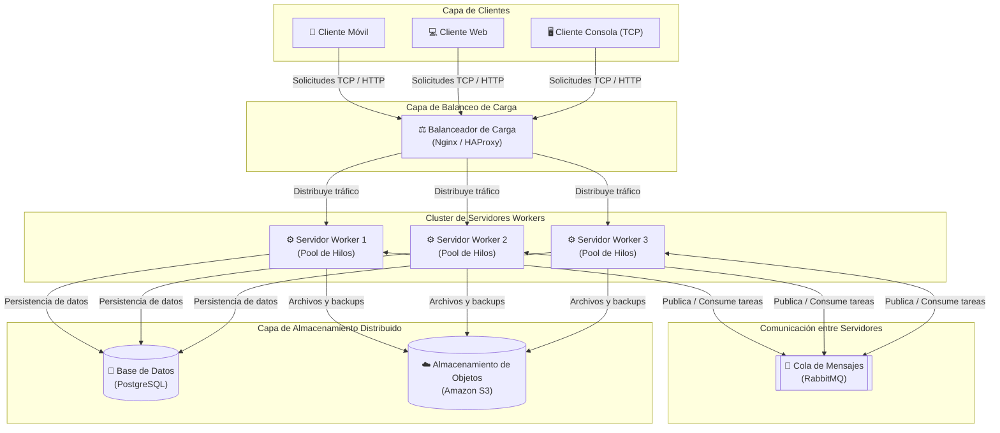
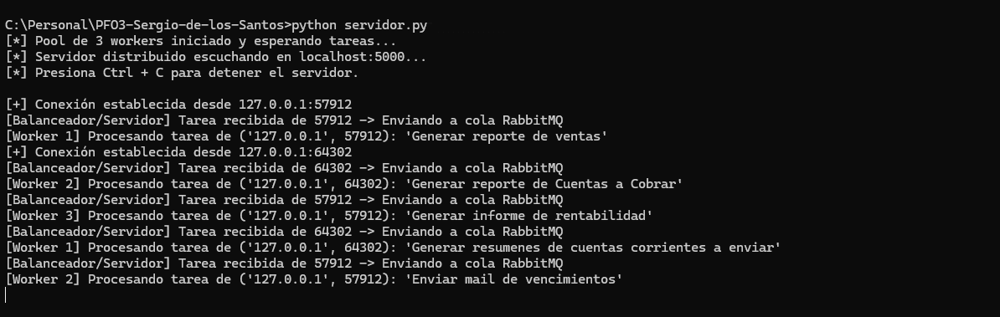
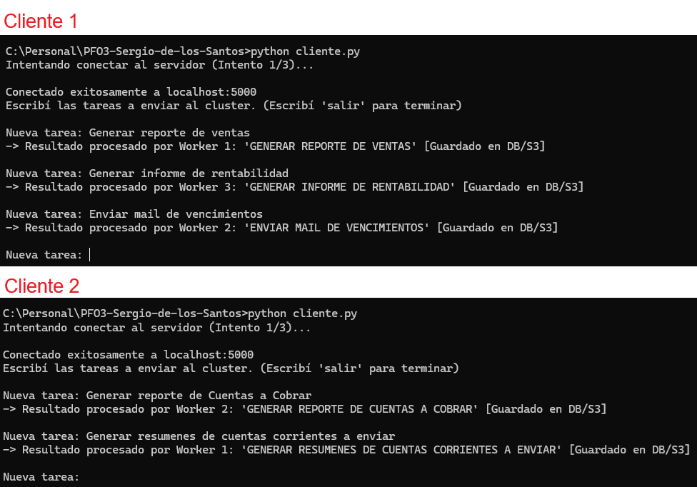

# PFO 3: Rediseño como Sistema Distribuido (Cliente-Servidor)

Trabajo Práctico N° 3 para la materia **Programación sobre Redes**.  
Rediseño de la aplicación hacia una arquitectura de sistema distribuido tolerante a fallos y escalable, implementando distribución de tareas mediante sockets TCP, colas de mensajes y un pool de hilos (*workers*) en Python.

---

## 1. Diagrama de Arquitectura del Sistema Distribuido

El siguiente diagrama ilustra la arquitectura diseñada, integrando clientes, balanceo de carga, servidores *workers* con sus respectivos pools de hilos, cola de mensajería asíncrona y almacenamiento distribuido:



### Descripción de los Componentes:
* **Clientes (Móviles, Web, Consola):** Envían tareas al sistema sin necesidad de conocer qué nodo interno las procesará (*transparencia de acceso*).
* **Balanceador de Carga (Nginx / HAProxy):** Punto de entrada único que reparte las conexiones entrantes entre los nodos activos para evitar cuellos de botella y asegurar alta disponibilidad.
* **Cola de Mensajes (RabbitMQ):** Desacopla la recepción de solicitudes del procesamiento pesado, garantizando que ninguna tarea se pierda si un nodo está ocupado.
* **Servidores Workers (con Pool de Hilos):** Nodos que toman tareas de la cola y las ejecutan de forma concurrente mediante hilos (*threading*), devolviendo el resultado al cliente.
* **Almacenamiento Distribuido (PostgreSQL y S3):** PostgreSQL gestiona los datos estructurados transaccionales y Amazon S3 almacena archivos estáticos, logs y copias de seguridad.

---

## 2. Implementación en Python (`servidor.py` y `cliente.py`)

Para demostrar el funcionamiento práctico del modelo con la biblioteca estándar de Python (siguiendo los contenidos de las Clases 1, 5, 10 y 11):
* **`servidor.py`:** Escucha conexiones por socket TCP en `localhost:5000`, acepta múltiples clientes en simultáneo usando hilos, encola las tareas recibidas en una estructura `queue.Queue` (simulando el rol de *RabbitMQ*) y las reparte entre un pool de **3 Workers concurrentes** que procesan el trabajo y devuelven la confirmación.
* **`cliente.py`:** Se conecta al servidor implementando lógica de **reintentos automáticos** en caso de demora o fallo temporal (visto en la Clase 10), permite enviar múltiples tareas interactivas y recibe los resultados de los *workers*.

---

## 3. Instrucciones de Ejecución y Pruebas

No se requieren librerías externas, ya que se utilizan módulos nativos de Python (`socket`, `threading`, `queue`, `time`).

### Paso 1: Iniciar el Servidor Distribuido
Abrir una terminal en la carpeta del proyecto y ejecutar:
```bash
python servidor.py
```
Verás que se inicia el pool de 3 *workers* y el servidor queda escuchando en `localhost:5000`.

### Paso 2: Ejecutar Múltiples Clientes en Simultáneo
Abrir **dos o más terminales adicionales** y ejecutar en cada una:
```bash
python cliente.py
```
Enviar tareas desde las distintas terminales casi al mismo tiempo. Podrás observar en la consola del servidor cómo la cola reparte el trabajo entre el `Worker 1`, `Worker 2` y `Worker 3` de manera concurrente, y cómo cada cliente recibe su resultado correspondiente. Para desconectar un cliente, escribir `salir`.

---

## 4. Capturas de Pantalla de las Pruebas

### Servidor distribuyendo tareas entre los Workers


### Clientes enviando tareas y recibiendo resultados
